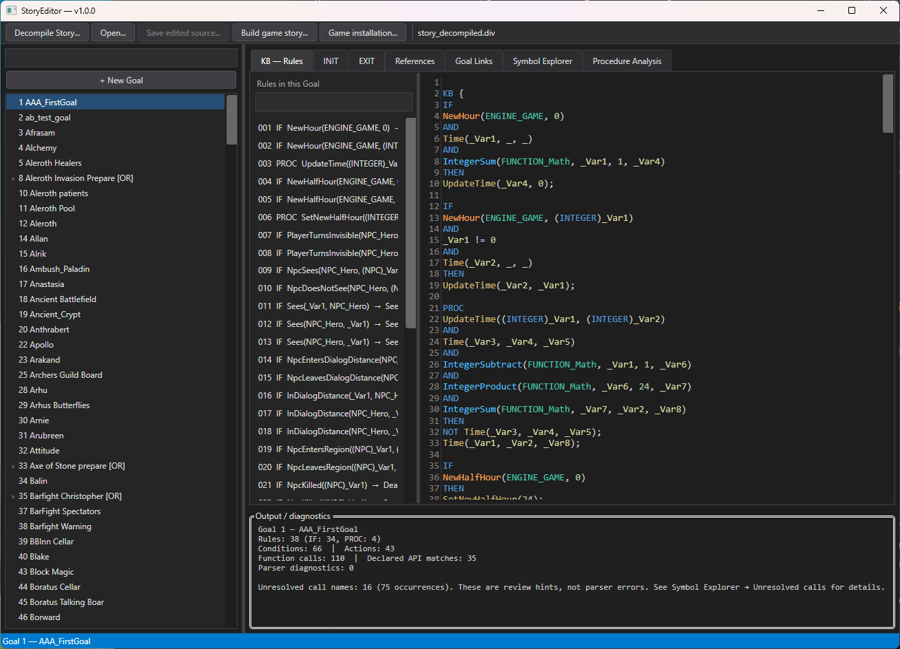

# StoryEditor

**StoryEditor** is a Windows desktop tool for inspecting, decompiling, editing, and rebuilding the Osiris Story data used by the classic game **Divine Divinity**.

It combines a WPF editor, a binary Story decompiler, and a build workflow based on the original 32-bit OsirisDLL.dll from the user's own game installation.

> **Status:** v1.1.0 is the current release. This version adds a live Osiris grammar validator, navigation from diagnostics, improved rule editing, editor assistance, and bilingual syntax help.

[Русская версия / Russian version](README.ru.md)

## Features

- **Binary decompilation:** read Story binaries (.000 / .001) and reconstruct editable .div source.
- **Goal navigation:** browse the Goal hierarchy and inspect INIT, KB, and EXIT sections.
- **Lifecycle editing:** edit INIT and EXIT action lists across Goals, with syntax and declared API signature checks.
- **Rule editing:** inspect IF and PROC rules, edit conditions and actions in a source-oriented editor, and validate structural changes before applying them.
- **Grammar validation:** continuously validate the complete Story source, including unsaved edits, with diagnostics for lexical, structural, rule, and INIT/EXIT syntax issues.
- **Editor assistance:** insert API actions and Story procedures from context menus, use symbol-aware autocomplete, and highlight matching brackets.
- **Bilingual help:** built-in Osiris syntax reference with English and Russian language switching.
- **Syntax highlighting:** consistent token coloring in all three KB, INIT, and EXIT editors, including Osiris keywords, literals, variables, objects, API function kinds, directives, and comments.
- **Source preservation:** retain untouched source text, whitespace, comments, and formatting where possible.
- **Cross-references:** search rules and usages across Goals.
- **Symbol Explorer:** inspect declared API symbols, Story procedures, and unresolved call candidates.
- **Goal Links:** explore explicit Goal-state references, Story procedure handler links, and clearly marked heuristic relationships.
- **Build and merge:** compile edited source with the original OsirisDLL and merge it with a selected base Story.
- **Read-only game inputs:** the editor does not overwrite installed game Story files.

## Requirements

### Running the published application

- Windows 10/11, 64-bit.
- A legitimate installation of Divine Divinity.
- The game's original OsirisDLL.dll and base main\startup\story.000.
- No separate .NET runtime installation is required by the self-contained Windows x64 package.

### Building a Story

The original Osiris DLL is a **32-bit** library. The build workflow therefore uses 32-bit Windows PowerShell:

    %WINDIR%\SysWOW64\WindowsPowerShell\v1.0\powershell.exe

This is normally present on 64-bit Windows. StoryEditor does not include or redistribute the game DLL or game data; users select their own installation.

### Building StoryEditor from source

- Windows 10/11.
- .NET 8 SDK.
- Internet access during the first restore to retrieve the AvalonEdit NuGet dependency.

## Installation

1. Download the Windows x64 release archive from the GitHub Releases page.
2. Extract it to a folder where you have read/write access.
3. Run StoryEditor.exe.
4. On first use, click **Game installation...** if the editor does not find the game automatically.
5. Select the game's OsirisDLL.dll. If required, select the base main\startup\story.000 file as well.

The selected installation is stored in:

    %LOCALAPPDATA%\StoryEditor\game-installation.json

Settings from the previous StoryEditor2 folder are migrated when they are read. No administrator rights should be required for normal use.

## Typical workflow

### 1. Decompile a Story binary

1. Start StoryEditor.
2. Click **Decompile Story...**.
3. Select a Story binary, such as the installed main\startup\story.000.
4. Choose where to save the generated .div file.
5. StoryEditor verifies that the binary was fully read and that all reconstructed rules were assigned before saving.
6. The resulting source is opened automatically.

The input binary is read-only and is never modified.

### 2. Inspect and edit

- Select a Goal in the hierarchy.
- Switch between INIT, KB, and EXIT. All three sections can be edited; INIT/EXIT changes are retained when switching between Goals. Syntax highlighting uses the same color scheme in all three editors.
- Use the rule list to navigate to IF and PROC rules.
- Use Cross References, Goal Links, and Symbol Explorer to inspect relationships and usages.
- Apply rule edits through the editor's validation workflow.
- Save to a separate .div file.

### 3. Build a separate Story binary

1. Ensure the correct game installation is configured.
2. Open the edited .div source.
3. Click **Build game story...**.
4. Choose a new output filename.
5. StoryEditor invokes the original 32-bit OsirisDLL, compiles the source, merges it with the selected base Story, and performs a read-only structural load check.

By default, build outputs are placed under:

    %USERPROFILE%\Documents\StoryEditor\Builds

The output must be a separate file. StoryEditor refuses to overwrite its input files and does not automatically install a build into the game directory. Back up game data before manually replacing anything.

## Grammar validation and output

The **Grammar** panel validates the complete current Story source in the background, including unsaved edits. It reports lexical, structural, IF/PROC rule, and INIT/EXIT syntax diagnostics. Double-click a diagnostic to navigate to its source location. The check is debounced while editing and does not block the UI.

The separate **Output** panel is used for build and operation messages. The Grammar summary includes rule, condition, KB action, and INIT/EXIT statement counts.

Unknown or unresolved call names are review candidates, **not automatically syntax errors**; INIT/EXIT may contain Story-defined facts. The complete list is available in **Symbol Explorer → Unresolved calls**. INIT/EXIT validation checks action syntax and known API call arity plus obvious literal/object type mismatches. The validator remains conservative and does not provide complete Osiris semantic or expression type validation.

## Standalone decompiler CLI

The repository also contains a command-line decompiler.

Decompile a binary:

    dotnet run --project .\StoryDecompiler\StoryDecompiler.csproj -- --decompile <story.000> <output.div>

Export the parsed Rete structure for diagnostics:

    dotnet run --project .\StoryDecompiler\StoryDecompiler.csproj -- --dump-rete <story.000> <output.json>

The CLI and WPF application share StoryDecompiler.Core.

## Build from source

From the repository root:

    dotnet restore .\StoryEditor.sln
    dotnet build .\StoryEditor.sln -c Release

Publish the self-contained single-file Windows x64 application:

    dotnet publish .\StoryEditor\StoryEditor.csproj -c Release -p:PublishProfile=win-x64

The publish profile is in StoryEditor\Properties\PublishProfiles\win-x64.pubxml. The application is written to the project's bin\Release\net8.0-windows\win-x64\publish directory.

The build scripts are embedded in the executable. When a build is requested, StoryEditor extracts them to %LOCALAPPDATA%\StoryEditor\Scripts. Both scripts must remain together because the main script invokes the validation script.

## Repository layout

    StoryEditor.sln
    StoryEditor/
      WPF application, UI, game installation settings, and publish profile
    StoryEditor.Core/
      Lexer, source structure and lifecycle-action parsers, Goal catalog, API signatures, and rule parser
    StoryEditor.RegressionTests/
      Package-free parser and binary Story regression test runner
    StoryDecompiler.Core/
      Shared binary reader, Rete reconstruction, and DIV source generator
    StoryDecompiler/
      Standalone command-line decompiler
    scripts/
      PowerShell source files embedded into the WPF application
    docs/research/
      Reverse-engineering notes and the Osiris DBase inventory (680 records)

The old internal C# namespaces retain the StoryEditor2 prefix for compatibility. The user-facing product, assembly, and executable are named **StoryEditor**.

## Research notes

- [Osiris DBase map](docs/research/osiris-dbase-map.md) - 680 typed databases, direct fact mappings, schemas, tuple counts, and validation notes.
- [Osiris DBase lineage report](docs/research/osiris-dbase-lineage.md) - Rete ownership and upstream function lineage for all 680 databases.
- [Osiris DBase lineage CSV](docs/research/osiris-dbase-lineage.csv) - one row per database with its direct owner and upstream functions.
- [Osiris INIT/EXIT audit](docs/research/osiris-init-exit-audit.md) - counts, decompiler coverage, source comparison, and current editor limitations.
- [Osiris DBase CSV inventory](docs/research/osiris-dbase-map.csv) - one row per database, including an example tuple where available.

## Known limitations

- The parser is a conservative implementation, not a complete Osiris grammar or semantic/type checker.
- Some engine calls may not be present in the current API catalogue. Unresolved-call entries are review hints.
- Cross-reference and Goal relationship analysis is source-level analysis; heuristic relationships are labelled as such.
- Automatic Steam/GOG installation discovery is bounded to known locations and registry/library metadata. It has not been verified on every store configuration.
- This MVP does not include every feature from the older WinForms editor.
- The published desktop application targets Windows x64. The Osiris DLL build host remains 32-bit.
- A clean-machine end-to-end test of the final GitHub Release archive is still recommended before announcing the release.

## Safety and compatibility

- Always keep backups of original game files and edited Story sources.
- Do not use the installed story.000 as the output filename.
- StoryEditor reads the selected game DLL and base Story as build inputs; it does not patch the installed game automatically.
- Do not redistribute OsirisDLL.dll, div.exe, or game archives. They are not part of this repository or release package.
- Use this tool only with game files you are legally entitled to use.

## License

StoryEditor is distributed under the [MIT License](LICENSE). You may use, copy, modify, merge, publish, distribute, sublicense, and sell copies of the software, subject to the license terms.

The MIT License applies to this repository's original source code. It does not grant rights to Divine Divinity, OsirisDLL.dll, div.exe, or any other third-party game assets or software.
